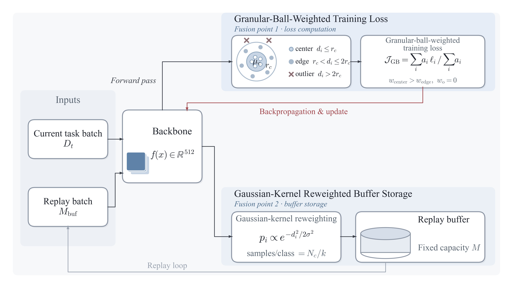

# Granular Ball-Guided Rehearsal for Online Continual Learning

Official PyTorch implementation of the paper:

> **Granular Ball-Guided Rehearsal for Online Continual Learning**
> Yetian Fan, Yuan Chen
> *School of Mathematics and Statistics, Liaoning University, Shenyang, China*

We propose **GBR** (Granular Ball-Guided Rehearsal), a plug-and-play framework that
incorporates granular-ball structure into rehearsal-based continual learning. Samples
are assigned **center / edge / outlier** roles by their distance to the class prototype
in feature space; these roles guide (1) training-loss weighting and (2) buffer
construction, while the network architecture and the online (single-pass) learning
setting of the underlying method are fully preserved.

<p align="center">
  
</p>

GBR is integrated with four rehearsal baselines:

| Baseline | Code model | GBR variant | Code model |
|---|---|---|---|
| ER | `er` | ER-GBR | `er_gbr` |
| DER++ | `derpp` | DER++-GBR | `derpp_gbr` |
| MIR | `mir` | MIR-GBR | `mir_gbr` |
| GSS | `gss` | GSS-GBR | `gss_gbr` |

Other continual learning baselines from the underlying framework (A-GEM, GEM, LwF,
iCaRL, GDumb, SCR, ...) are also available under `models/`.

## Installation

The code is tested with Python 3.10, PyTorch 2.5.1 (+cu124) on Windows / Linux.

```bash
# 1) install PyTorch (CUDA 12.4 build) from the official index first
pip install torch==2.5.1 torchvision==0.20.1 --index-url https://download.pytorch.org/whl/cu124

# 2) install the remaining dependencies
pip install numpy==2.2.6 tqdm==4.67.3 Pillow==12.1.1 matplotlib==3.10.8 six==1.17.0
```

Optional dependencies:

- `quadprog` is needed only for GEM / A-GEM;
- `googledrivedownloader` is needed only for the automatic Tiny-ImageNet download
  (otherwise place the dataset manually, see below).

## Datasets and data preparation

Experiments use three class-incremental benchmarks: **seq-CIFAR-10**, **seq-CIFAR-100**
and **seq-Tiny-ImageNet** (`seq-tinyimg`). The dataset root is controlled by the
environment variable `DATA_PATH` (defaults to `./datasets/`; the path should end with a
separator). Datasets are expected at:

```
<DATA_PATH>/CIFAR10/    # torchvision CIFAR-10, downloaded automatically on first run
<DATA_PATH>/CIFAR100/   # torchvision CIFAR-100, downloaded automatically on first run
<DATA_PATH>/TINYIMG/    # tiny-imagenet-processed (see below)
```

For seq-Tiny-ImageNet, place the processed Tiny-ImageNet archive used by the Mammoth
framework (`tiny-imagenet-processed.zip`, Google Drive file id
`1Sy3ScMBr0F4se8VZ6TAwDYF-nNGAAdxj`) at `<DATA_PATH>/TINYIMG/` and extract it so that
`<DATA_PATH>/TINYIMG/processed/` exists. Datasets themselves are **not** distributed
with this repository.

## Running experiments

All experiments are launched from the repository root via:

```bash
python utils/main.py --model <model> --dataset <dataset> --backbone resnet18 \
    --lr 0.03 --batch_size 32 --minibatch_size 32 --n_epochs 1 \
    --buffer_size <M> --seed <seed> --gpu_id 0 --exp formal_s<seed>
```

This is the exact configuration used for the paper's main results (SGD with momentum 0
and weight decay 0, one epoch per task, ResNet-18 backbone). Results are written to
`results/<dataset>/<model>/epoch1/buf<M>/<exp>/results.pkl`.

Buffer sizes per dataset: **seq-CIFAR-10**: M ∈ {200, 500}; **seq-CIFAR-100**:
M ∈ {2000, 5000}; **seq-Tiny-ImageNet**: M ∈ {2000, 5000}. All main-table results are
averaged over 10 seeds (`--seed 5000` ... `--seed 5009`).

Examples:

```bash
# ER-GBR on seq-CIFAR-100, M=2000 (granular-ball parameters use the model defaults)
python utils/main.py --model er_gbr --dataset seq-cifar100 --backbone resnet18 \
    --lr 0.03 --batch_size 32 --minibatch_size 32 --n_epochs 1 \
    --buffer_size 2000 --seed 5000 --gpu_id 0 --exp formal_s5000

# DER++ baseline on seq-CIFAR-10, M=200
python utils/main.py --model derpp --dataset seq-cifar10 --backbone resnet18 \
    --lr 0.03 --batch_size 32 --minibatch_size 32 --n_epochs 1 \
    --buffer_size 200 --seed 5000 --gpu_id 0 --exp formal_s5000

# GSS / GSS-GBR require --batch_num (number of batches extracted from the buffer)
python utils/main.py --model gss_gbr --dataset seq-tinyimg --backbone resnet18 \
    --lr 0.03 --batch_size 32 --minibatch_size 32 --n_epochs 1 \
    --buffer_size 2000 --batch_num 1 --seed 5000 --gpu_id 0 --exp formal_s5000
```

Notes:

- always pass `--exp` with a unique name per run (e.g. `formal_s5000`) so that results
  of different seeds are not overwritten;
- MIR / MIR-GBR accept `--mir_cands` (default 50);
- DER++ / DER++-GBR accept `--alpha` (default 0.2) and `--beta` (default 0.5).

Batch drivers used for the paper's runs are provided in `scripts/`
(`run_batch_fill.py`, `run_batch_tinyimg.py`); each run is re-launched only if its
`results.pkl` is missing, so they are resumable. Per-model mean ± std of ACC / FGT can
be recomputed from raw results with `scripts/aggregate_main_std.py`, and ablation tables
with `scripts/aggregate_ablation.py`.

## Granular-ball hyperparameters

The GBR variants share four hyperparameters. The paper's experiments use the **built-in
defaults** of each model file (obtained by PSO tuning):

| Model | `--center_weight` | `--edge_weight` | `--gaussian_sigma` | `--buffer_k` |
|---|---|---|---|---|
| `er_gbr` | 1.81 | 0.33 | 0.91 | 3 |
| `derpp_gbr` | 1.75 | 0.96 | 1.54 | 14 |
| `mir_gbr` | 1.81 | 0.33 | 0.91 | 3 |
| `gss_gbr` | 1.20 | 0.61 | 0.67 | 5 |

- `center_weight` / `edge_weight`: loss weights of center / edge samples (outliers get
  zero weight) in the granular-ball weighted loss;
- `gaussian_sigma` / `buffer_k`: parameters of the Gaussian-kernel reweighted buffer
  storage;
- `--no_gb_weight` disables the granular-ball loss weighting; `--no_gaussian_sampling`
  disables the Gaussian-kernel reweighted storage (both used in the ablation study).

## Repository structure

```
├── backbone/          # ResNet / MLP backbones and meta-learning layers
├── dataset/           # sequential dataset definitions and transforms
├── models/            # continual learning methods (baselines + *_gbr)
├── utils/             # entry point (main.py), training loop, buffer, logging
├── scripts/           # batch runners and result aggregation
├── pics/              # paper figures
└── results/           # experiment outputs (created at runtime)
```

## Citation

If you find this code useful, please cite our paper:

```bibtex
@article{fan2026gbr,
  title   = {Granular Ball-Guided Rehearsal for Online Continual Learning},
  author  = {Fan, Yetian and Chen, Yuan},
  journal = {under review},
  year    = {2026}
}
```

## Acknowledgements

This codebase is built upon the [Mammoth](https://github.com/aimagelab/mammoth)
continual learning framework, which also provides the ER and DER++ implementations.
The MIR and GSS baselines follow the original codebases
([MIR](https://github.com/optimass/Maximally_Interfered_Retrieval),
[GSS](https://github.com/rahafaljundi/Gradient-based-Sample-Selection)). We thank the
authors for releasing their code.

## License

The code inherits the license headers of the upstream Mammoth framework (see the
header of each source file). A top-level `LICENSE` file is not yet included and will be
added by the authors.
